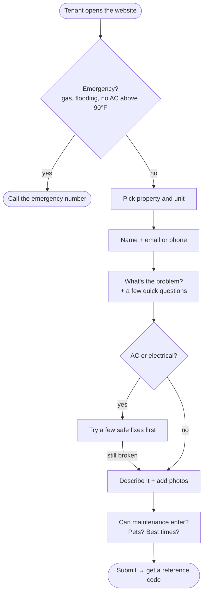
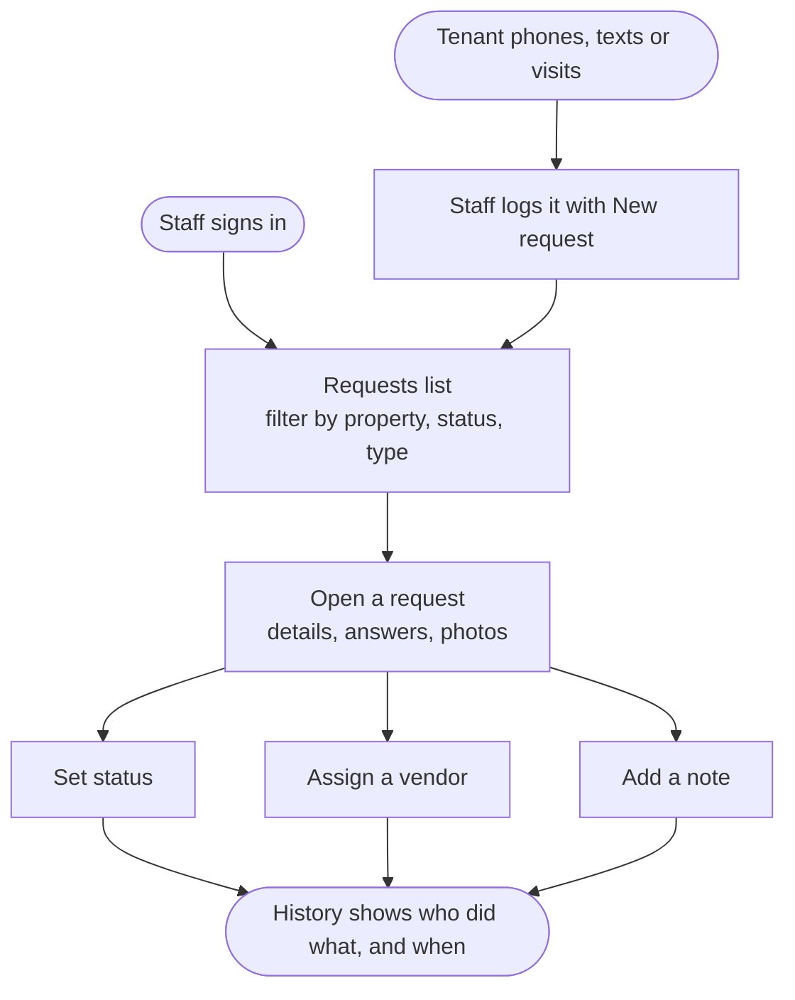

# Maintenance Request Tool

A simple website for a property management company (~75 rental units).

- **Tenants** report problems through one online form. No account or password needed.
- **Staff** sign in to see every request, track progress, assign vendors and keep notes.

---

## For tenants

1. Go to the website and tap **Submit a maintenance request**.
2. Pick your property and unit, and give your name plus an email or phone number.
3. Choose what's wrong (AC/heating, plumbing, electrical, pests, appliance, door/lock, other) and answer a couple of quick questions.
4. For some problems (like AC or electrical), the form suggests a few safe things to try first — such as checking the breaker. If that doesn't fix it, carry on.
5. Describe the problem, add up to 3 photos, and say whether maintenance can enter when you're not home.
6. Submit and get a **reference code** (like `MR-7KQ2X9`) to keep.

**Emergencies:** a red notice at the top of every page says: gas smell, flooding, or no AC above 90°F — don't use the form, call the emergency number. It appears again if you answer that water is leaking right now.

---

## For staff

**Sign in** with the email and password the office set up for you. (There's no public sign-up — staff accounts are created by the office.)

| Page | What you can do |
|---|---|
| **Requests** | See every request, newest first. Filter by property, status or problem type. |
| **Request details** | See everything the tenant sent, including photos. Change the status, assign a vendor, add notes. |
| **New request** | Log a request that came in by phone, text or in person. |
| **Vendors** | Add, rename or deactivate vendors (plumber, electrician, pest control…). |

**Statuses:** New → Scheduled → Waiting on vendor → Done

**Badges on the list help you spot things that need a closer look:**
- 🟠 **Unverified contact** — the email/phone doesn't match anyone on file for that unit. The request is still accepted; it might be a new tenant, a family member, or a typo.
- 🔴 **Vacant unit** — the request is for a unit that's listed as empty.
- ⚪ **Phone / Text / In person** — staff logged it on the tenant's behalf.

**History:** every change — status, vendor, note — is recorded with who did it and when, so anyone can pick up a request and see the full story.

---

## How tenant data is kept safe

- **Tenants can't see anything** — not other requests, not who lives where. Submitting a request only gives back a reference code.
- **The form never reveals who lives in a unit.** It doesn't fill in names or say "we found you"; the thank-you screen is the same for everyone.
- **Only staff can see requests**, and only after signing in with an account the office created.
- **Photos are private.** Staff see them through links that stop working after 10 minutes.
- **Uploads are checked** — only real images, at most 3, shrunk on the phone before sending so they upload quickly.
- **Spam protection** — a hidden trap field catches most bots.

---

## Importing units and tenants

The office's spreadsheet of units and tenants (`data/sample_units.csv`) is loaded with one command. It's safe to run more than once.

It cleans up obvious things (extra spaces, "Bayview flats" vs "Bayview Flats", duplicate rows) but **never changes tenant details on its own**. Anything that looks wrong — like `gmial.com`, a phone number that's too short, or an impossible date — is kept as-is and listed in a report so someone can fix it properly.

---

## What I'd do next

- **Email/text updates** to tenants when their request is scheduled or done.
- **"Check my request"** page where a tenant enters their reference code to see the status.
- **Limit how often** one person can submit, to stop floods of fake requests.
- **Manage staff accounts** from the website instead of in Supabase.
- **Simple reports** — e.g. how long requests take, which units have the most problems.

---

## Running it yourself (for developers)

Built with Nuxt 3, Tailwind CSS and Supabase. Hosted on Vercel.

1. Create a Supabase project and run `supabase/migrations/0001_init.sql` in its SQL editor. Turn off public sign-ups (Authentication → Sign In / Providers).
2. Copy `.env.example` to `.env` and fill in the Supabase URL, anon key and service role key.
3. Use Node 22 (`nvm use`), then `npm install`.
4. Import units: `npm run import:units` (add `-- --dry-run` to preview the report).
5. Create a staff login in Supabase (Authentication → Users → Add user, tick *Auto Confirm*), then add them to the staff list:
   `insert into staff (email, name) values ('you@example.com', 'Your Name');`
6. `npm run dev` and open http://localhost:3000. Staff sign in at `/login`.

**Where to change things:** categories, questions, quick fixes, statuses and the emergency number all live in one file — `config/maintenance.ts`.

More detail on the tenant form: [docs/tenant-form-flow.md](docs/tenant-form-flow.md).
