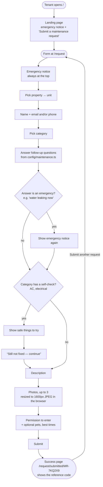
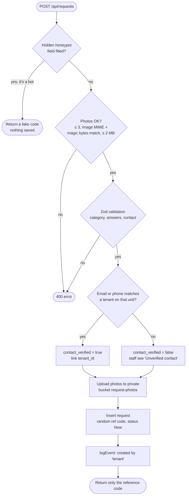

# Tenant form — how it works

Pages: `/` (landing), `/request` (form), `/request/submitted/[ref]` (success) · Component: `components/RequestForm.vue` · API: `POST /api/requests`

## What the tenant sees

## What happens on submit (server)

The response is the same whether or not the contact matched, so the form never
reveals who lives in a unit.
